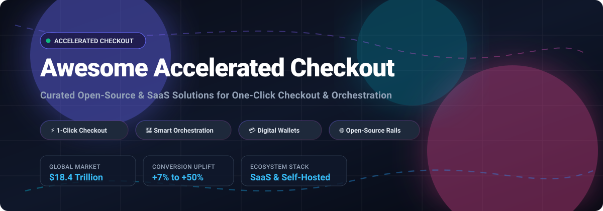

<p align="center">
  
</p>

# Awesome Accelerated Checkout

[](https://awesome.re)
[](LICENSE)
[](https://github.com/ishandutta2007/Awesome-Accelerated-Checkout/pulls)
[](https://github.com/ishandutta2007/Awesome-Accelerated-Checkout/stargazers)

> A curated directory of premier **SaaS platforms**, **digital wallets**, **express checkout buttons**, and **open-source payment orchestration infrastructure** powering frictionless one-click purchases worldwide.

Accelerated checkout solutions minimize drop-off rates at checkout by recognizing returning customers and autofilling authenticated payment credentials and shipping addresses. This repository contrasts massive proprietary wallet networks with merchant-sovereign, self-hosted payment orchestration stacks.

---

## Table of Contents

- [Sector Overview & Market Dynamics](#sector-overview--market-dynamics)
- [SaaS & Hosted Platforms](#saashosted-platforms)
- [Open-Source GitHub Projects](#open-source-github-projects)
- [Architecture & Framework Comparison](#architecture--framework-comparison)
- [How to Contribute](#how-to-contribute)
- [Disclaimer & Security Considerations](#disclaimer--security-considerations)

---

## Sector Overview & Market Dynamics

The global digital payments and accelerated checkout market is projected to expand beyond **$18.4 trillion by 2030**, spurred by mobile-first commerce, passkeys/biometric tokenization, and consumer expectations for sub-10-second checkouts. 

Market dynamics demonstrate a **highly concentrated, winner-take-all structure** at the consumer wallet tier—dominated by massive walled gardens and tech titans (Apple, Alphabet, Amazon, PayPal, and Shopify) where proprietary identity networks and cross-merchant buyer graphs create nearly insurmountable network effects. In contrast, the underlying payment orchestration, multi-processor routing, and gateway abstraction layers remain **moderately fragmented and increasingly open-source**, enabling enterprise merchants to avoid processor vendor lock-in, optimize interchange fees, and retain transaction sovereignty.

---

## SaaS/Hosted Platforms

The following hosted platforms provide accelerated checkout, universal digital wallets, and express button integrations. Entries are sorted in descending order by company valuation / annual market revenue.

| Platform | Valuation / Revenue Scale | Pricing (Starting Tier) | Free Tier / Trial Limits | Key Capabilities & Ideal Use Case |
| :--- | :--- | :--- | :--- | :--- |
| **[Apple Pay](https://www.apple.com/apple-pay/)** | **$3.5 Trillion** Market Cap ($391B Annual Revenue) | **$0.00** direct fee ($99/year Apple Developer Program required) | **No free tier** (Requires active $99/year Apple Developer Account) | Built-in Face ID / Touch ID hardware authorization with device-bound tokenization. Best for iOS/macOS merchant apps & Safari web checkout. |
| **[Google Pay](https://pay.google.com/)** | **$2.2 Trillion** Market Cap ($350B Annual Revenue) | **$0.00** direct fee ($25 one-time Google Play developer fee if publishing Android apps) | **Free plan forever** (Free API access; standard gateway processor fees apply) | Integrated Android/Chrome checkout utilizing Google Accounts, biometrics, and tokenized network cards. |
| **[Amazon Pay](https://pay.amazon.com/)** | **$1.9 Trillion** Market Cap ($600B Annual Revenue) | **2.9% + $0.30** per domestic web transaction | **Free plan forever** (No monthly subscription or setup fee; pay-per-transaction only) | Seamless checkout leveraging 300M+ active Amazon user accounts, addresses, and saved payment profiles. |
| **[Shop Pay](https://shop.app/)** | **$120 Billion** Market Cap ($8.8B Annual Revenue) | **2.4% + $0.30** per transaction (Requires Shopify Basic plan starting at **$39/month**) | **3-day free trial** (Full feature access during 3-day trial period, followed by $1 for first month promotion) | Merchant network with 250M+ registered buyers, yielding up to 50% higher conversions than guest checkouts. |
| **[PayPal One Touch](https://www.paypal.com/)** | **$70 Billion** Market Cap ($31B Annual Revenue) | **2.59% + $0.49** per card/PayPal transaction | **Free plan forever** (Zero monthly maintenance fees; charges apply strictly per settled transaction) | Persistent 6-month authenticated session state enabling passwordless one-click repeat checkouts across the global PayPal buyer network. |
| **[Link by Stripe](https://link.com/)** | **$70 Billion** Private Valuation ($16B+ Annual Revenue) | **2.9% + $0.30** per card transaction via Stripe Payments | **Free plan forever** (Included with all Stripe standard accounts; zero monthly subscription fees) | Global autofill payment network across millions of Stripe-connected merchants, driving +7% average conversion uplift. |
| **[Venmo](https://venmo.com/)** | **Subsidiary of PayPal** ($70B Parent Valuation; ~$1B+ standalone revenue) | **3.49% + $0.49** per transaction via PayPal Braintree | **Free plan forever** (No monthly merchant account fee; variable rate per processed transaction) | High-engagement mobile P2P checkout preferred by Gen-Z and Millennial US shoppers, integrated via Braintree. |
| **[Click to Pay](https://clicktopay.com/)** | **Card Networks Consortium** (Visa: $580B, Mastercard: $460B, Amex: $180B) | **$0.00** network surcharge (Standard acquirer card processing interchange rates apply) | **Free plan forever** (Open industry specification via EMVCo, Adyen, Stripe, and global acquirers) | Universal EMVCo card industry standard supporting biometric and OTP verification across Visa, Mastercard, and Amex without proprietary walled gardens. |
| **[Bolt](https://www.bolt.com/)** | **$300 Million** Valuation (Peak: $11B in 2022) | **2.9% + $0.30** per transaction (Custom annual enterprise contracts negotiated) | **No free tier** (Requires dedicated enterprise sales agreement and custom underwriting) | One-click checkout, passwordless identity verification (Bolt Check-In), and integrated fraud prevention scoring. |

*(Note: [Fast](https://fast.co/) raised $125M but shut down in April 2022; it is omitted from the active SaaS directory as defunct infrastructure).*

---

## Open-Source GitHub Projects

Open-source checkout infrastructure provides self-hosted payment orchestration, smart transaction routing, ledger transparency, and cart checkout simplifications.

Repos are sorted in descending order by **GitHub Star Count**:

| Repository & Stars | Description | Stack | License |
| :--- | :--- | :--- | :--- |
| **[juspay/hyperswitch](https://github.com/juspay/hyperswitch)**<br>[](https://github.com/juspay/hyperswitch/stargazers) | **High-performance payment orchestration platform**. Connects to 100+ processors (Stripe, Adyen, Braintree, Checkout.com) with smart dynamic routing, automatic retries, zero processor lock-in, and PCI-compliant vaulting. | Rust, TypeScript, React | Apache-2.0 |
| **[medusajs/medusa](https://github.com/medusajs/medusa)**<br>[](https://github.com/medusajs/medusa/stargazers) | **Digital commerce engine for high-growth merchants**. Fully modular architecture featuring headless checkout flows, multi-gateway payment sessions, and multi-region tax/currency calculation. | Node.js, TypeScript | MIT |
| **[saleor/saleor](https://github.com/saleor/saleor)**<br>[](https://github.com/saleor/saleor/stargazers) | **Composable, headless e-commerce platform** offering an ultra-fast GraphQL API, modular payment app architecture, and multi-channel express checkout orchestration. | Python (Django), GraphQL, Next.js | BSD-3-Clause |
| **[spree/spree](https://github.com/spree/spree)**<br>[](https://github.com/spree/spree/stargazers) | **Complete open-source e-commerce platform** with built-in fast checkout workflows, Stripe Element / Apple Pay / Google Pay integrations, and multi-store management. | Ruby on Rails | BSD-3-Clause |
| **[getlago/lago](https://github.com/getlago/lago)**<br>[](https://github.com/getlago/lago/stargazers) | **Open-source metering and billing API**. Manages subscription checkouts, payment orchestration across Stripe/Adyen/GoCardless, usage aggregation, and automated invoicing. | Go, Ruby on Rails | AGPL-3.0 |
| **[btcpayserver/btcpayserver](https://github.com/btcpayserver/btcpayserver)**<br>[](https://github.com/btcpayserver/btcpayserver/stargazers) | **Self-hosted, zero-fee Bitcoin and Lightning Network payment processor**. Complete checkout gateway with QR code express payments, point-of-sale apps, and WooCommerce/Shopify plugins. | C# (.NET) | MIT |
| **[thephpleague/omnipay](https://github.com/thephpleague/omnipay)**<br>[](https://github.com/thephpleague/omnipay/stargazers) | **Multi-gateway payment processing library for PHP**. Provides a clean, unified API for integrating dozens of card gateways and wallet endpoints with identical syntax. | PHP | MIT |
| **[killbill/killbill](https://github.com/killbill/killbill)**<br>[](https://github.com/killbill/killbill/stargazers) | **Open-source subscription billing and payments platform**. Enterprise-grade payment router supporting multiple acquirers, customizable checkout dunning, and localized currency rails. | Java | Apache-2.0 |
| **[solidusio/solidus](https://github.com/solidusio/solidus)**<br>[](https://github.com/solidusio/solidus/stargazers) | **High-customization e-commerce framework** featuring headless checkout APIs, customizable one-step checkout pipelines, and Braintree/PayPal multi-rail support. | Ruby on Rails | BSD-3-Clause |
| **[activemerchant/active_merchant](https://github.com/activemerchant/active_merchant)**<br>[](https://github.com/activemerchant/active_merchant/stargazers) | **Shopify-originated extraction library** abstracting dozens of payment gateways through a battle-tested Ruby interface. | Ruby | MIT |
| **[payum/payum](https://github.com/payum/payum)**<br>[](https://github.com/payum/payum/stargazers) | **Payment processing framework for PHP** featuring out-of-the-box support for PayPal Express, Stripe, Klarna, recurring subscriptions, and custom checkout flows. | PHP | MIT |
| **[fluent-cart/fluent-cart](https://github.com/fluent-cart/fluent-cart)**<br>[](https://github.com/fluent-cart/fluent-cart/stargazers) | **High-performance WordPress commerce solution** with built-in instant one-click checkout, headless REST endpoints, and zero-bloat database tables. | PHP (WordPress) | GPL-3.0 |
| **[interledger/rafiki](https://github.com/interledger/rafiki)**<br>[](https://github.com/interledger/rafiki/stargazers) | **Open Payments and Interledger protocol implementation**. Powers frictionless peer-to-peer and merchant payments across diverse global accounts and currencies. | TypeScript, Node.js | Apache-2.0 |
| **[amwal-tech/amwal-magento](https://github.com/amwal-tech/amwal-magento)**<br>[](https://github.com/amwal-tech/amwal-magento/stargazers) | **Magento 2 extension for biometric one-click checkout**. Enables immediate purchase directly from mini-carts, product pages, and catalog grids. | PHP (Magento 2) | OSL-3.0 |
| **[tpt-solutions/tpt-payments](https://github.com/tpt-solutions/tpt-payments)**<br>[](https://github.com/tpt-solutions/tpt-payments/stargazers) | **Self-hostable Stripe-compatible payment API** backed by an append-only double-entry ledger, webhook engine, and sandbox acquiring adapter. | Go, PostgreSQL, NATS | MIT |

---

## Architecture & Framework Comparison

```
+--------------------------------------------------------------------------+
|                        CONSUMER CHECKOUT LAYER                           |
|  [Apple Pay]  [Google Pay]  [Shop Pay]  [Link by Stripe]  [PayPal Touch] |
|              - Saved Identity & Shipping Token Storage                   |
|              - Passkey / Biometric Authentications                       |
+--------------------------------------------------------------------------+
                                    |
                                    v
+--------------------------------------------------------------------------+
|                  PAYMENT ORCHESTRATION & ROUTING LAYER                   |
|                   [Hyperswitch]  [Kill Bill]  [Lago]                     |
|              - Dynamic Smart Routing & Fallbacks                         |
|              - Card Tokenization & Multi-PSP Load Balancing              |
|              - Interchange Cost Optimization                             |
+--------------------------------------------------------------------------+
                                    |
                                    v
+--------------------------------------------------------------------------+
|                     ACQUIRER & GATEWAY PROCESSORS                        |
|        [Stripe]   [Adyen]   [Braintree]   [BTCPay]   [Worldpay]          |
+--------------------------------------------------------------------------+
```

### The Identity Network vs. Open Infrastructure Dichotomy
- **Proprietary SaaS Networks (Shop Pay, Link, PayPal, Apple Pay)**: Deliver conversion lifts (+7% to +50%) because the consumer has previously verified their credentials on another website. These buyer graphs are strictly closed-source and cannot be replicated via a self-hosted codebase alone.
- **Open-Source Infrastructure (Hyperswitch, Medusa, BTCPay, Omnipay)**: Solves the merchant side of the equation—granting total sovereignty over transaction routing, fallback rules on processor downtime, lower interchange processing fees, and self-custodied ledger integrity.

---

## How to Contribute

We welcome additions, updates, and corrections from the community:

1. **Fork** the repository.
2. Create a new branch: `git checkout -b feature/add-new-checkout-tool`.
3. Add or update items in `README.md` following the standardized table structure:
   - For SaaS: include specific starting tier pricing, explicit free tier limits, and valuation/revenue scale.
   - For Open-Source: include the repo badge `[](https://github.com/{owner}/{repo}/stargazers)` and keep the table sorted by stargazers count.
4. Verify all markdown URLs and formatting.
5. Commit and submit a **Pull Request** detailing your additions.

---

## Disclaimer & Security Considerations

- **PCI DSS Compliance**: Handling un-tokenized card data requires strict adherence to PCI DSS Level 1–4 audits. Self-hosted payment engines should always be paired with certified card vaults or iframe-hosted input fields.
- **Defunct Startups**: Fast ($125M raised, folded in 2022) highlights the difficulty of creating an independent wallet network without existing merchant density. Ensure high due diligence when adopting venture-backed single-purpose checkout platforms.
- **Merchant Verification**: Always review current developer documentation and terms directly on the official providers' portals prior to production implementation.

---

<p align="center">
  <sub>Maintained for software engineers, product architects, and fintech teams building state-of-the-art checkout experiences.</sub>
</p>
